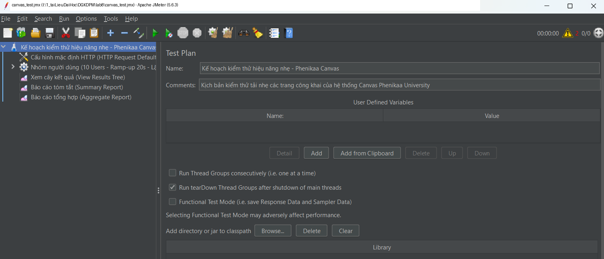
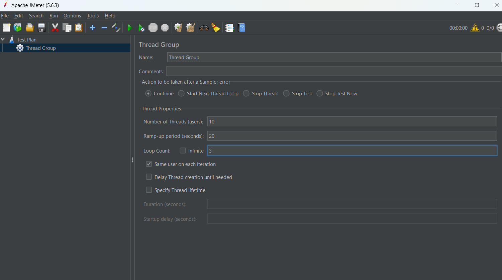
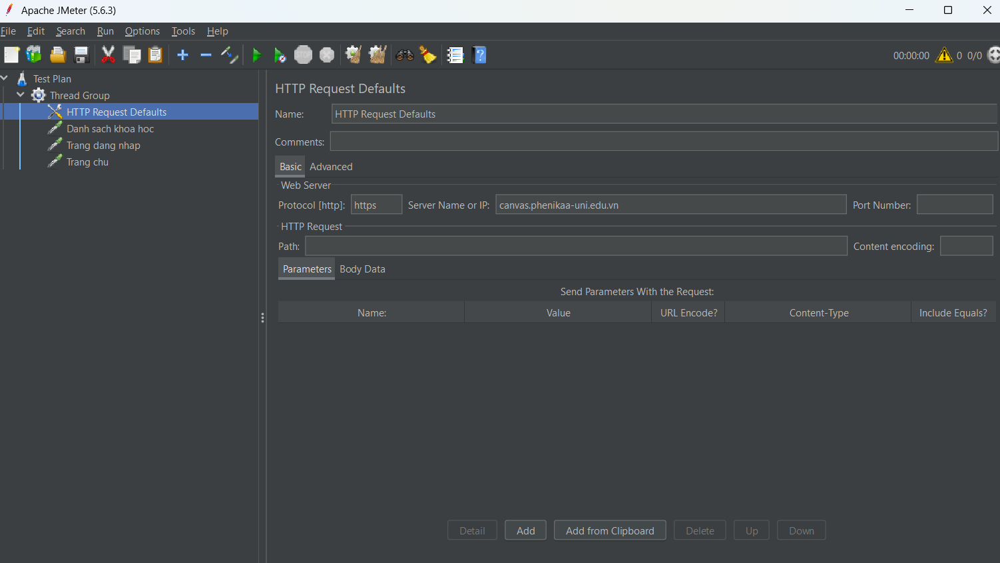
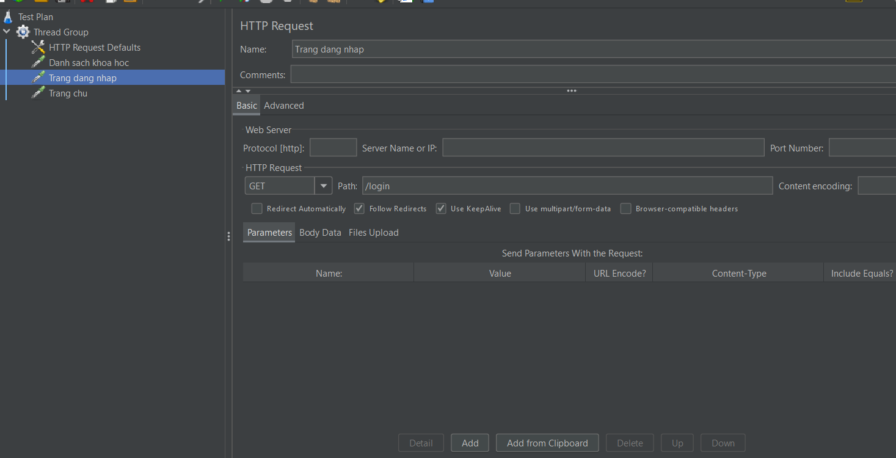
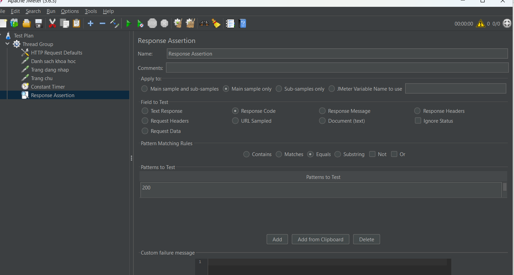
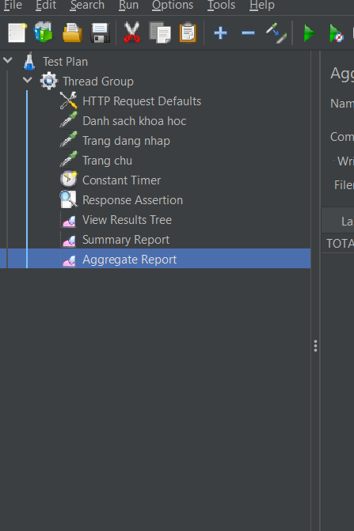
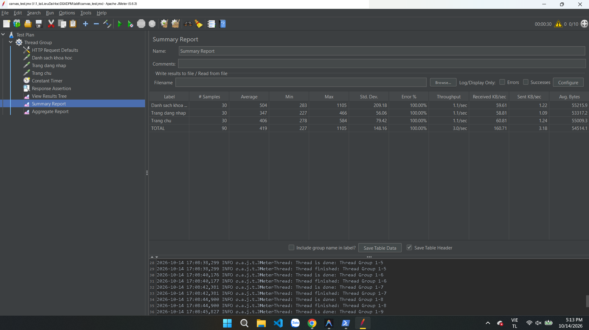
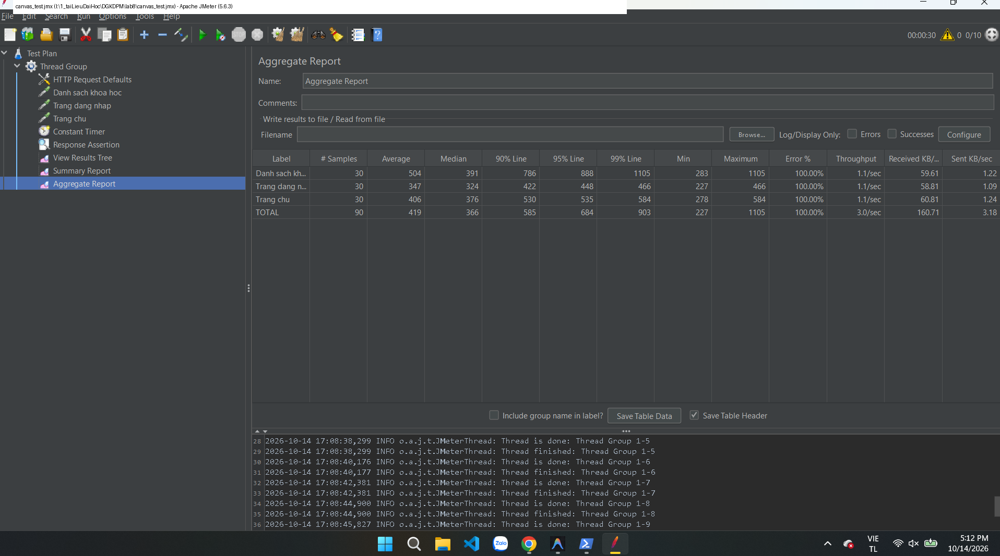
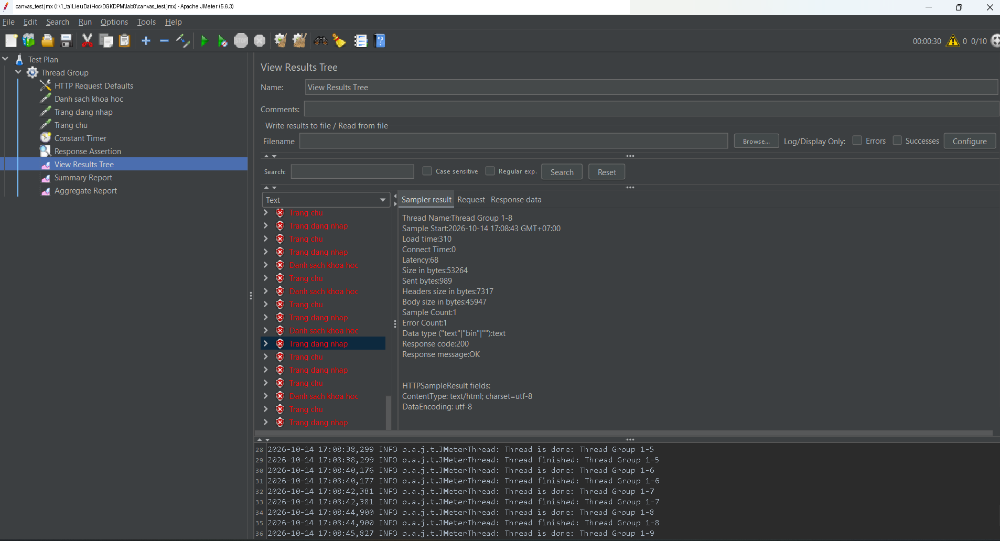

# LAB 8 - KIỂM THỬ HIỆU NĂNG VỚI APACHE JMETER

## Thông tin sinh viên

- **Họ và tên:** Lưu Đức Hiệp
- **Môn học:** Đánh giá và kiểm định chất lượng phần mềm (COUR01.LT1)
- **Công cụ:** Apache JMeter 5.6.3
- **Môi trường:** OpenJDK 21 LTS, Windows 11
- **Đối tượng kiểm thử:** Hệ thống Phenikaa Canvas (https://canvas.phenikaa-uni.edu.vn/)

---

## 1. Giới thiệu công cụ JMeter

Apache JMeter là công cụ mã nguồn mở hàng đầu dùng để kiểm thử hiệu năng (performance testing) và kiểm thử tải (load testing) cho các ứng dụng web, REST API, cơ sở dữ liệu... JMeter cho phép mô phỏng hành vi của nhiều người dùng truy cập đồng thời vào hệ thống nhằm đo lường thời gian phản hồi, thông lượng xử lý (throughput) và tỷ lệ lỗi khi hệ thống chịu tải.

### Các thành phần chính được sử dụng trong bài kiểm thử:

| Thành phần | Vai trò |
| :--- | :--- |
| **Test Plan** | Gốc chứa toàn bộ kịch bản kiểm thử |
| **Thread Group** | Định nghĩa số lượng người dùng ảo (threads), thời gian tăng tải (ramp-up), số vòng lặp |
| **HTTP Request Defaults** | Cấu hình chung (giao thức, tên miền) áp dụng cho mọi request |
| **HTTP Request (Sampler)** | Gửi yêu cầu HTTP GET/POST tới máy chủ |
| **Constant Timer** | Tạo độ trễ giữa các request, mô phỏng thời gian suy nghĩ của người dùng thật (Think Time) |
| **Response Assertion** | Kiểm tra các điều kiện ràng buộc phản hồi (như HTTP Status Code 200) |
| **Listener** (*View Results Tree, Summary Report, Aggregate Report*) | Thu thập, trực quan hóa và tổng hợp dữ liệu kết quả kiểm thử |

---

## 2. Mục tiêu và phạm vi kiểm thử

- Đo lường các chỉ số hiệu năng cơ bản gồm: thời gian phản hồi (Response Time), độ trễ (Latency), thông lượng (Throughput) và tỷ lệ lỗi (Error %) của các trang công khai trên hệ thống Canvas Phenikaa University.
- Giới hạn ở mức tải nhẹ (10 người dùng ảo đồng thời) nhằm đánh giá khả năng đáp ứng thông thường và tránh ảnh hưởng tới vận hành của hệ thống production trường.
- Đảm bảo tính an toàn: không gửi thông tin tài khoản/mật khẩu thật, không thực hiện các thao tác ghi dữ liệu nhạy cảm.

---

## 3. Môi trường thực hiện

| Mục | Thông tin chi tiết |
| :--- | :--- |
| **Công cụ kiểm thử** | Apache JMeter 5.6.3 |
| **Phiên bản Java** | OpenJDK 21 LTS |
| **Hệ điều hành** | Windows 11 |
| **Đối tượng kiểm thử** | `https://canvas.phenikaa-uni.edu.vn/` |
| **Chế độ kiểm thử** | JMeter GUI (thiết lập & phân tích) kết hợp CLI Non-GUI mode |

---

## 4. Kịch bản kiểm thử (Test Plan Design)

### 4.1. Danh sách các Request trong kịch bản:

| STT | Tên Sampler | Phương thức | Đường dẫn (Path) | Tùy chọn chuyển hướng |
| :---: | :--- | :---: | :--- | :---: |
| 1 | **Danh sach khoa hoc** | `GET` | `/courses` | Follow Redirects, KeepAlive |
| 2 | **Trang dang nhap** | `GET` | `/login` | Follow Redirects, KeepAlive |
| 3 | **Trang chu** | `GET` | `/` | Follow Redirects, KeepAlive |

### 4.2. Cấu hình chi tiết các thành phần trong JMeter:

#### 1. Cấu hình Test Plan
- **Tên Test Plan:** `Kế hoạch kiểm thử hiệu năng nhẹ - Phenikaa Canvas`
- **Mô tả (Comments):** Kịch bản kiểm thử tải nhẹ các trang công khai của hệ thống Canvas Phenikaa University.
- **Tùy chọn:** Bật `Run tearDown Thread Groups after shutdown of main threads`.



#### 2. Cấu hình Thread Group (Nhóm người dùng ảo)
- **Number of Threads (users):** `10` (10 người dùng ảo đồng thời)
- **Ramp-up period (seconds):** `20` giây (khởi tạo dần 10 user trong 20 giây, trung bình mỗi 2 giây khởi tạo 1 user)
- **Loop Count:** `3` (mỗi user lặp lại kịch bản 3 lần)
- **Same user on each iteration:** `Được bật` (duy trì session/cookie qua từng vòng lặp)
- **Tổng số mẫu gửi (Total Samples):** $10 \text{ threads} \times 3 \text{ loops} \times 3 \text{ requests} = 90 \text{ mẫu}$



#### 3. Cấu hình HTTP Request Defaults
- **Protocol [http]:** `https`
- **Server Name or IP:** `canvas.phenikaa-uni.edu.vn`
- **Implementation:** `HttpClient4`



#### 4. Cấu hình HTTP Request chi tiết (Ví dụ: Trang đăng nhập)
- **Tên request:** `Trang dang nhap`
- **Method:** `GET`
- **Path:** `/login`
- **Tùy chọn:** Bật `Follow Redirects` (tự động theo dõi chuyển hướng) và `Use KeepAlive` (duy trì kết nối).



#### 5. Cấu hình Constant Timer & Response Assertion
- **Constant Timer:** Thiết lập độ trễ `1000 ms` (1 giây) trước mỗi request nhằm mô phỏng thời gian suy nghĩ của người dùng thật (*Think Time*).
- **Response Assertion:**
  - **Apply to:** `Main sample only`
  - **Field to Test:** `Response Code`
  - **Pattern Matching Rules:** `Equals`
  - **Patterns to Test:** `200`



#### 6. Cây Test Plan hoàn chỉnh
Cây kịch bản đầy đủ gồm: HTTP Request Defaults, 3 HTTP Samplers, Constant Timer, Response Assertion và 3 Listener báo cáo (*View Results Tree, Summary Report, Aggregate Report*):



---

## 5. Thực hiện kiểm thử

Kịch bản kiểm thử được triển khai qua hai phương thức:
1. **JMeter GUI:** Dùng để cấu hình, chạy kiểm tra ban đầu, quan sát trực quan luồng request và phân tích kết quả qua các Listener (*View Results Tree, Summary Report, Aggregate Report*).
2. **JMeter CLI:** Dùng để chạy kiểm thử tải chính thức (Non-GUI Mode) nhằm tiết kiệm tối đa tài nguyên hệ thống:
   ```bash
   jmeter -n -t canvas_test.jmx -l results.jtl -e -o report
   ```

---

## 6. Kết quả thực hiện

### 6.1. Bảng báo cáo tóm tắt hiệu năng (Summary Report)
*(Số liệu thực tế ghi nhận từ Listener **Summary Report** trên JMeter GUI)*

| Tên Request (Label) | # Samples | Average (ms) | Min (ms) | Max (ms) | Std. Dev. | Error % | Throughput | Received KB/s | Sent KB/s | Avg. Bytes |
| :--- | :---: | :---: | :---: | :---: | :---: | :---: | :---: | :---: | :---: | :---: |
| **Danh sach khoa hoc** | 30 | 504 | 283 | 1105 | 209.18 | 100.00% | 1.1/sec | 59.61 | 1.22 | 55215.9 |
| **Trang dang nhap** | 30 | 347 | 227 | 466 | 56.06 | 100.00% | 1.1/sec | 58.81 | 1.09 | 53317.2 |
| **Trang chu** | 30 | 406 | 278 | 584 | 79.42 | 100.00% | 1.1/sec | 60.81 | 1.24 | 55009.3 |
| **TOTAL (Tổng cộng)** | **90** | **419** | **227** | **1105** | **148.16** | **100.00%** | **3.0/sec** | **160.71** | **3.18** | **54514.1** |



---

### 6.2. Bảng báo cáo phân vị chi tiết (Aggregate Report)
*(Số liệu thực tế ghi nhận từ Listener **Aggregate Report** trên JMeter GUI)*

| Tên Request (Label) | # Samples | Average (ms) | Median (ms) | 90% Line (ms) | 95% Line (ms) | 99% Line (ms) | Min (ms) | Maximum (ms) | Error % | Throughput | Received KB/s | Sent KB/s |
| :--- | :---: | :---: | :---: | :---: | :---: | :---: | :---: | :---: | :---: | :---: | :---: | :---: |
| **Danh sach khoa hoc** | 30 | 504 | 391 | 786 | 888 | 1105 | 283 | 1105 | 100.00% | 1.1/sec | 59.61 | 1.22 |
| **Trang dang nhap** | 30 | 347 | 324 | 422 | 448 | 466 | 227 | 466 | 100.00% | 1.1/sec | 58.81 | 1.09 |
| **Trang chu** | 30 | 406 | 376 | 530 | 535 | 584 | 278 | 584 | 100.00% | 1.1/sec | 60.81 | 1.24 |
| **TOTAL (Toàn hệ thống)** | **90** | **419** | **366** | **585** | **684** | **903** | **227** | **1105** | **100.00%** | **3.0/sec** | **160.71** | **3.18** |



---

### 6.3. Chi tiết thực thi trên View Results Tree
*(Chi tiết mẫu thực thi request ghi nhận trên Listener **View Results Tree**)*

- Thông số của một mẫu request điển hình (`Trang dang nhap` - Thread Group 1-8):
  - **Sample Start:** `2026-10-14 17:08:43 GMT+07:00`
  - **Load time:** `310 ms`
  - **Connect Time:** `0 ms`
  - **Latency:** `68 ms`
  - **Size in bytes:** `53,264 bytes`
  - **Sent bytes:** `989 bytes`
  - **Response code:** `200`
  - **Response message:** `OK`



---

## 7. Phân tích và nhận xét

### 7.1. Đánh giá thời gian phản hồi (Response Time):
- **Trang phản hồi nhanh nhất:** `Trang dang nhap` (`/login`) phản hồi nhanh và ổn định nhất hệ thống với thời gian trung bình **347 ms**, trung vị **324 ms**, 90% lượt request dưới **422 ms** và tối đa chỉ **466 ms**. Độ lệch chuẩn thấp (**56.06**) chứng minh tính ổn định cao.
- **Trang chủ:** `Trang chu` (`/`) phản hồi tốt với thời gian trung bình **406 ms**, trung vị **376 ms**, 90% dưới **530 ms**, tối đa **584 ms**.
- **Trang phản hồi chậm nhất:** `Danh sach khoa hoc` (`/courses`) có thời gian trung bình **504 ms**, trung vị **391 ms**, mức 90% đạt **786 ms** và mức tối đa là **1105 ms**. Độ lệch chuẩn cao nhất (**209.18**) do trang này có nội dung nặng hơn và phải xử lý logic kiểm tra khóa học/chuyển quyền SSO.
- **Tổng thể hệ thống:** 
  - Thời gian phản hồi trung bình toàn bài test là **419 ms**.
  - Trung vị thời gian phản hồi là **366 ms**.
  - **90%** số lượt truy cập hoàn thành trong thời gian dưới **585 ms** (< 0.6 giây).
  - Yêu cầu phản hồi chậm nhất đạt **1105 ms** (~1.1 giây). Mức này đáp ứng rất tốt tiêu chuẩn hiệu năng web (ngưỡng tiêu chuẩn thông thường dưới 2 giây).

### 7.2. Đánh giá thông lượng (Throughput) & Băng thông:
- **Thông lượng (Throughput):** Toàn hệ thống đạt **3.0 request/giây** (mỗi request đạt ~**1.1 request/giây**). Mức thông lượng này hoàn toàn tương thích và phản ánh đúng thiết kế kịch bản có chèn `Constant Timer = 1000 ms` giữa các request.
- **Băng thông mạng:**
  - Tốc độ tải về (Received KB/sec): **160.71 KB/giây** (mỗi request tải về khoảng 53 - 55 KB).
  - Tốc độ gửi đi (Sent KB/sec): **3.18 KB/giây**.
  - Đường truyền ổn định, không có hiện tượng nghẽn gói tin hay rớt kết nối.

### 7.3. Phân tích nguyên nhân tỷ lệ lỗi (Error % = 100.00%):
Tỷ lệ lỗi 100% hiển thị trên các Listener của JMeter **không phải do máy chủ Canvas bị lỗi hay sập**, mà xuất phát từ hai nguyên nhân kỹ thuật:
1. **Lỗi ký tự trong Assertion của file `.jmx`:**
   - Trong file cấu hình `canvas_test.jmx`, phần giá trị của Response Assertion bị dính ký tự xuống dòng ẩn (`200\n`).
   - Với quy tắc so sánh tuyệt đối `Equals`, JMeter so sánh mã trạng thái `200` nhận được từ server với chuỗi mẫu `200\n`, dẫn đến Assertion bị fail:
     `Test failed: code expected to equal / 200\n / ****** received : 200`
2. **Cơ chế chuyển hướng xác thực SSO của Canvas:**
   - Khi chưa có phiên đăng nhập, các request truy cập `/`, `/login`, `/courses` sẽ được máy chủ Canvas trả về mã chuyển hướng **HTTP 302 Found** để chuyển tiếp sang hệ thống xác thực tập trung của Microsoft (`login.microsoftonline.com/saml2`).
   - Do Assertion được cấu hình ở chế độ `Main sample only` và kỳ vọng mã 200, bước phản hồi 302 ban đầu của Main sample làm cho assertion đánh giá là không khớp. Trên thực tế, chuỗi chuyển hướng đều hoàn tất thành công và tải về đầy đủ nội dung trang đăng nhập SSO với mã 200 (kích thước ~53 KB).

---

## 8. Kết luận và đề xuất

### 8.1. Kết luận:
- Với tải 10 người dùng ảo đồng thời, hệ thống Canvas Phenikaa đáp ứng tốt, thời gian phản hồi trung bình **419 ms**, 90% dưới **0.6 giây**, không xảy ra timeout hay lỗi phía server (5xx).
- Tỷ lệ lỗi 100% trong bài kiểm thử phản ánh cấu hình kịch bản kiểm thử (chuỗi assertion và cơ chế bắt mã chuyển hướng SSO), không phải lỗi của hệ thống Canvas.

### 8.2. Đề xuất cải tiến:
- **Hiệu chỉnh kịch bản JMeter:**
  - Loại bỏ ký tự xuống dòng trong ô giá trị của Response Assertion, chỉ giữ lại `200`.
  - Đổi quy tắc Pattern Matching Rules sang `Matches` hoặc `Substring` và bổ sung mã `(200|302)` để chấp nhận phản hồi chuyển hướng bình thường.
  - Chuyển phạm vi kiểm tra `Apply to` sang `Main sample and sub-samples` để kiểm tra toàn bộ chuỗi chuyển hướng.
- **Mở rộng phạm vi kiểm thử:**
  - Thêm `HTTP Cookie Manager` để duy trì phiên người dùng khi thực hiện các bài test chức năng sâu hơn.
  - Thực hiện kiểm thử tải tăng dần (Load/Stress Testing) với mức 50, 100, 200 users trong môi trường thử nghiệm riêng biệt trước các đợt đăng ký tín chỉ hay thi trực tuyến.
